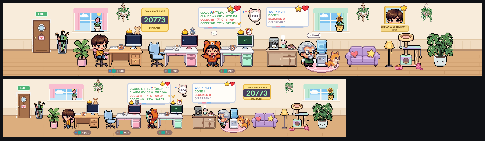

# Usage whiteboard for Herdr Office

A second whiteboard on the [office](https://github.com/DustyPolk/herdr-office) wall, just left of the cat clock, showing how much of your **Claude Code** and **Codex** limits you've used.



*(Approximate render made outside Herdr.)*

```
CLAUDE 5H   42%  4:40P
CLAUDE WK   68%  WED 10A
CODEX  5H   71%  6:40P
CODEX  WK   22%  SAT 7P
```

- **Same board as the office's own.** It's drawn by the office's own whiteboard function, so it matches your office version. The windows and pictures along the wall move over to make room.
- **Each line is colored by pace, not just size:**
  - green: at this rate the window lasts until it resets
  - yellow: a bit ahead of pace
  - red: it runs out before the reset, or it's nearly gone
- **The last column is when that window resets:** a time today, or a day and hour.
- **Hover a line** for the exact reset time, how far through the window you are, and how old the reading is. Readings over 3 hours old are drawn faded, because the numbers only change while each tool runs.
- **A toast at 80% and at 95%** of any window, once per window.

## Where the numbers come from

- **Claude Code** gives `rate_limits.five_hour` and `seven_day` to your status line but doesn't save them. `tap.cjs` goes in front of your status line command (`node ".../tap.cjs" | your command`). It saves them to `~/.config/herdr-app/usage/claude.json` and passes the same input on, so your status line looks the same as before. You only get these numbers with a Pro/Max subscription, and only after the session's first response.
- **Codex** writes its limits into its session logs (`~/.codex/sessions/…`). `codex-usage.cjs` reads the newest one about once a minute, and only reads it.

Nothing goes over the network, and no tokens are read.

## Install

You need Node.js (`node` on PATH).

```powershell
cd C:\Github\herdr-usage-board
node setup.cjs install
node setup.cjs status
```

The install does three things, keeping a `.bak-<time>` of each file it changes:

1. Adds `usage.js` to `mods/office/`, and four lines to the office's `main.js`, each ending in `// usage-board`. Before changing anything, it checks that your `main.js` has the lines those four go next to.
2. Puts the helpers in `~/.config/herdr-app/usage/`, outside the office folder, so updating the office won't touch them.
3. Adds the tap in front of your Claude Code `statusLine` command.

If the earlier usage panel (`mods/usage-board`) is installed, the install takes it out.

Claude's numbers appear after its next status line update (send it a message).

**After updating the office from GitHub:** run `node setup.cjs install` again, since the update replaces `main.js`.

## Roll back

```powershell
node setup.cjs uninstall
```

It takes out exactly the four marked lines, so `main.js` is back byte for byte. It also removes `usage.js` and the helpers, and puts your status line back as it was.

## Settings

These live in `~/.config/herdr-app/usage/settings.json`. Install never overwrites it.

| Setting | Default | What it does |
|---|---|---|
| `node` | `"node"` | How to run the Codex helper; a full path if `node` isn't on PATH |
| `alerts` | `[80, 95]` | Toast thresholds; `[]` for none |
| `codexHome` | `null` | Codex's folder (`$CODEX_HOME` or `~/.codex`) |

## Watch out

- **Status line commands that chain** (`a && b`, `a; b`). A pipe in front would only feed the first part, so setup stops without changing anything. Move the command into a script and point `statusLine` at that.
- **Narrow strips.** When the strip is too narrow for the board between the door and the clock, it doesn't show.
- **Per-model weekly caps.** If your plan has these, Claude Code doesn't include them in the status line data, so they aren't shown.

## Tests

```sh
node --import ./tests/register.mjs tests/test.mjs
```

The suite covers:
- pace and labels
- the tap, through a real shell pipe
- the Codex reader, including a log over 1 MiB
- install, render, status and uninstall against both office versions (before and after the Nov 13 sprite redraw), with Windows line endings and with the earlier panel installed; `main.js` comes back byte for byte
- refusing, with nothing changed, when the office or the status line doesn't fit
